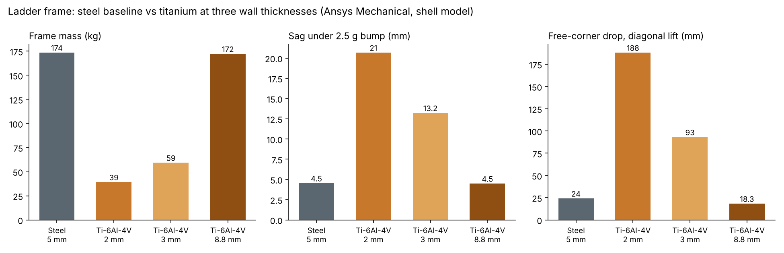
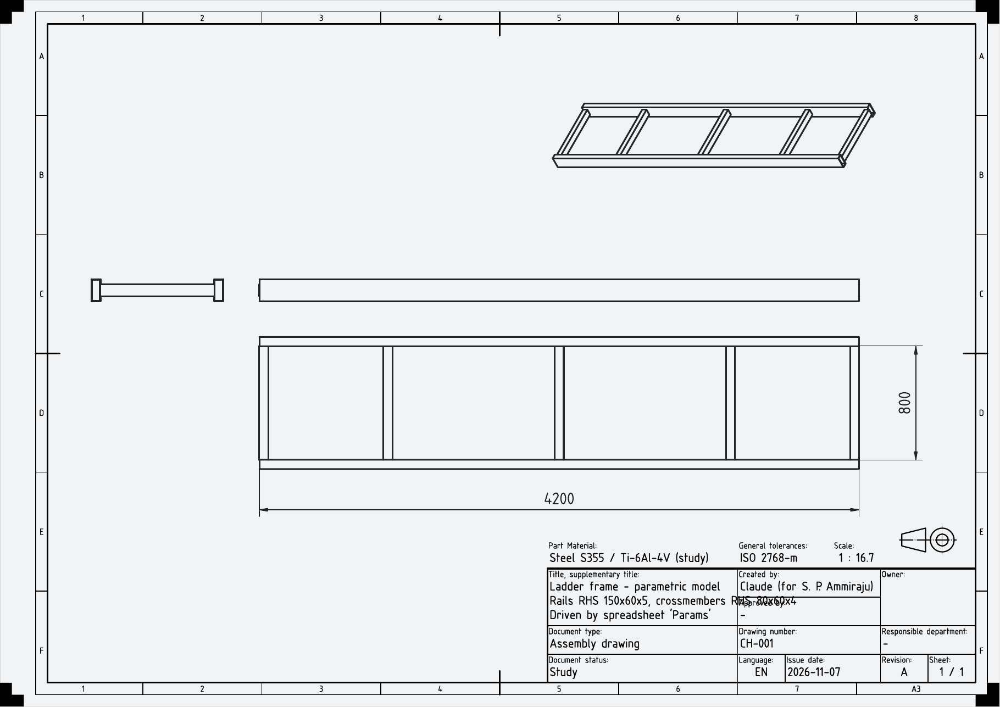
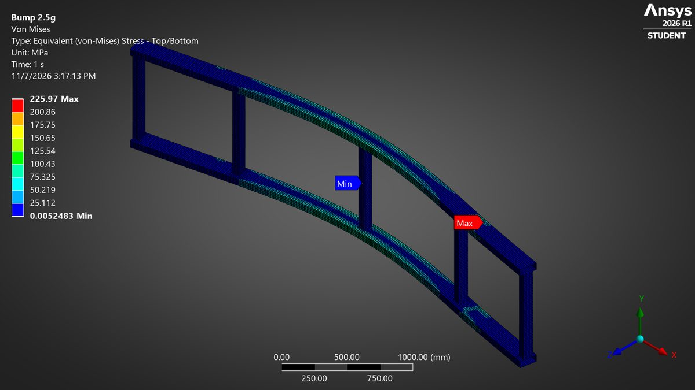
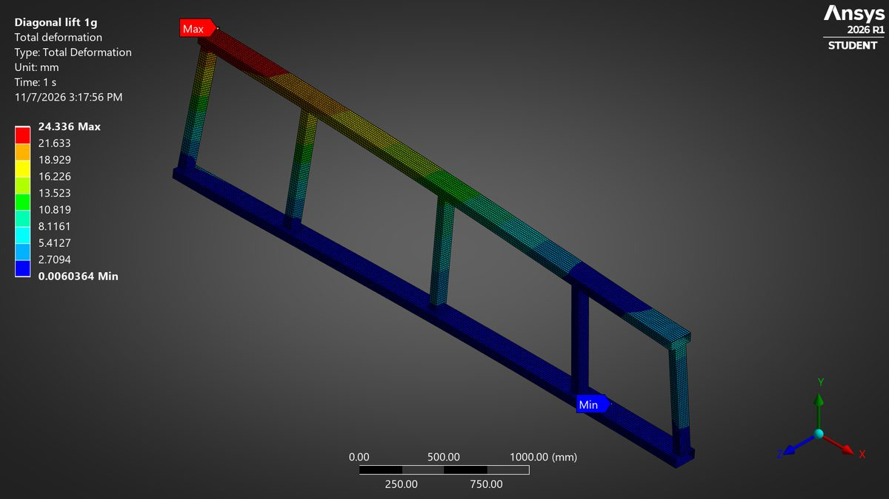
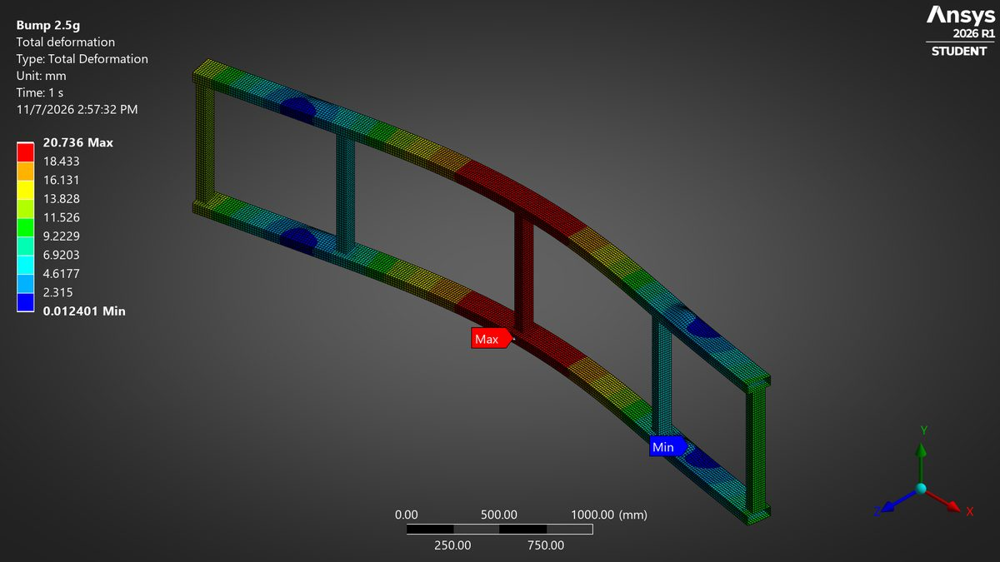
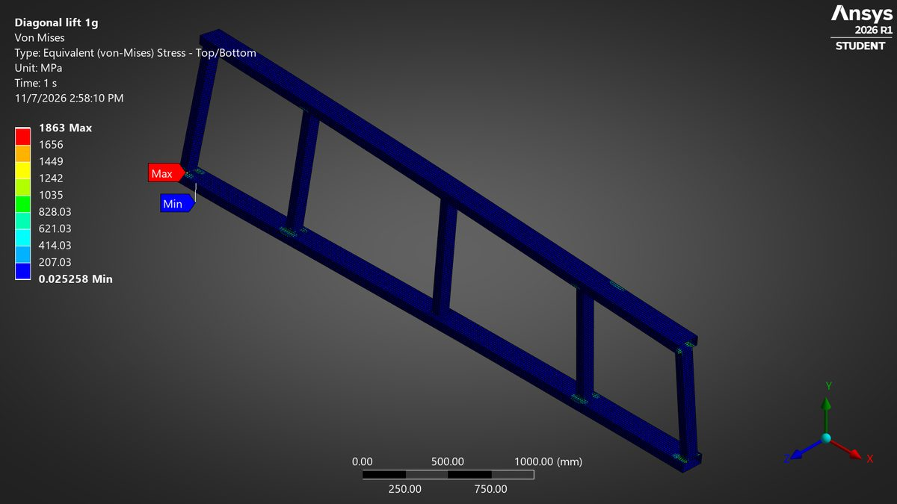
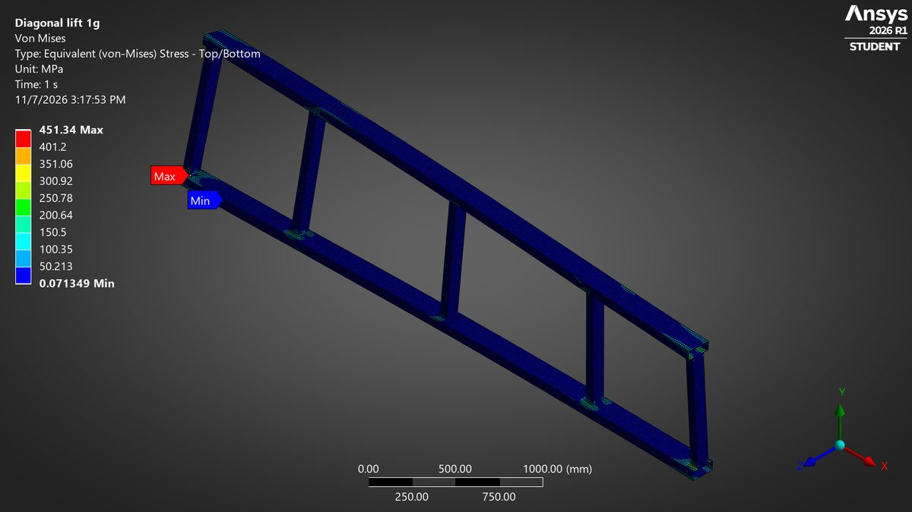

# Ladder-frame chassis FEA: steel vs titanium

How much weight do you really save by building a vehicle ladder frame in Ti-6Al-4V instead of steel?
I modelled a 4.2 m ladder frame in **FreeCAD**, ran it through **Ansys Mechanical 2026 R1**, and compared a
steel frame with three titanium versions under a bump and a twisting load. I wanted a number I could defend,
not the usual "titanium is lighter".

**Short answer:** it depends on what limits the design. That surprised me more than it should have.

- Sized for strength, titanium is a big win. A 2 mm Ti frame matches the steel frame's safety factor and
  weighs **39 kg instead of 174 kg** (77 % lighter).
- Sized for stiffness, it saves almost nothing. That's the part people skip. Titanium's Young's modulus is 57 % of steel's, so a frame
  as stiff as the steel one needs 8.8 mm walls and weighs **172 kg**.
- The thin Ti frames bring their own problems. At 2 mm the frame sags 4.6x more on a bump, twists about
  8x more, and buckles at roughly 6 g, before the metal ever yields.



## CAD model (FreeCAD)



`cad/ladder_frame_parametric.FCStd` is a Part Design model. I kept it parametric so the titanium variants are a spreadsheet edit, not a remodel:

- Each rail is a sketched hollow section (150 x 60 mm, 5 mm wall) padded to the 4200 mm frame length.
- The five crossmembers (80 x 60 mm, 4 mm wall) are one sketch padded symmetrically between the rails.
- Every dimension is linked to the **Params** spreadsheet. Change the wall thickness or a crossmember
  station there and the frame rebuilds.
- Mass check: the solid model weighs 173.4 kg in steel; the FEA shell model gives 173.6 kg.

Also in `cad/`: a STEP export of the solid frame and an A3 drawing (PDF).

## FEA setup (Ansys Mechanical)

`ansys_project/chassis_steel_vs_titanium.mechdb` opens in Mechanical with the full model tree.

| Item | Setting |
| --- | --- |
| Geometry | Midsurface of the frame, meshed as shells with thickness assigned per part |
| Joints | Mesh connections join rails and crossmembers along their shared edges (welded joints) |
| Mesh | Quadratic shell elements, 15 mm, about 72 000 nodes |
| Axle mounts | 100 mm pads under each rail at x = 700 mm and 3500 mm (2800 mm wheelbase), remote displacements so the pads act as pins |
| Loads on frame | Cab + powertrain 1100 kg over x = 500 to 2400 mm; payload 1500 kg over x = 2400 to 4200 mm; frame self-weight |

| Material | E (GPa) | Poisson | Density (kg/m3) | Yield (MPa) |
| --- | --- | --- | --- | --- |
| Steel S355 | 200 | 0.30 | 7850 | 355 |
| Ti-6Al-4V (annealed) | 113.8 | 0.342 | 4430 | 880 |

Load cases:

1. **Bump, 2.5 g.** Every load and the frame's own weight times 2.5. Rear mounts pinned, front mounts held
   vertically only.
2. **Diagonal lift, 1 g.** Front-left wheel off the ground, so the frame sits on three mounts and twists.
3. **Eigenvalue buckling**, pre-stressed by the bump case.

## Results

| Design | Walls, rail / cross (mm) | Mass (kg) | Bump stress (MPa) | Bump SF | Twist stress (MPa) | Twist SF | Bump sag (mm) | Twist corner drop (mm) | Buckling factor |
| --- | --- | --- | --- | --- | --- | --- | --- | --- | --- |
| Steel S355 (baseline) | 5.0 / 4.0 | 173.6 | 86.9 | 4.1 | 104.6 | 3.4 | 4.5 | 24.1 | > 50 |
| Ti-6Al-4V, same strength | 2.0 / 1.6 | 39.2 | 213.4 | 4.1 | 281.3 | 3.1 | 20.7 | 188 * | **2.4** |
| Ti-6Al-4V, 3 mm | 3.0 / 2.5 | 59.3 | 139.2 | 6.3 | 171.1 | 5.1 | 13.2 | 93 | 8.1 |
| Ti-6Al-4V, same stiffness | 8.8 / 7.0 | 172.3 | 50.3 | 17.5 | 50.9 | 17.3 | 4.5 | 18.3 | > 50 |

Stresses are far-field von Mises values: I take every node more than 50 mm from a joint or mount pad. SF is
yield divided by that stress. A buckling factor of 2.4 means the 2 mm frame's rail web buckles at
2.4 x 2.5 g, about 6 g.

\* Linear analysis. A 188 mm corner drop is past where small-deflection results hold, so I'd read it as
"very flexible" rather than an exact figure.

| Steel, bump 2.5 g | Steel, diagonal lift |
| --- | --- |
|  |  |
| **Ti-6Al-4V 2 mm, bump 2.5 g (deformation)** | **Ti-6Al-4V 2 mm, diagonal lift (stress)** |
|  |  |

### The joints

Peak stresses sit where the crossmembers meet the rails and at the mount pads, well above the far-field
numbers: 451 MPa in the steel frame under diagonal lift, 1863 MPa in the 2 mm Ti frame. In a shell model
those sharp corners are singularities. Going from a 15 mm to a 12 mm mesh pushed the steel joint peak from
451 to 500 MPa while the far-field stress stayed put (104.6 vs 104.4 MPa), so I don't use the peaks for the
safety factor. What they do tell me is that the joints need gussets or brackets, and for thin titanium that
detail work, plus weld quality, would be a big part of a real design.



## Checks

| Check | Result |
| --- | --- |
| Hand beam calc vs FEA, steel bump stress | 83.4 MPa vs 86.9 MPa (+4 %) |
| Hand beam calc vs FEA, steel bump sag | 4.40 mm vs 4.54 mm (+3 %) |
| Same for Ti 2 / 3 / 8.8 mm | Stress +6 / +3 / +6 %, sag +11 / +6 / +2 % (the shell model adds shear and local wall bending) |
| Reactions, steel bump | 68 024 N = 63 765 N applied + 2.5 x 173.6 kg x g |
| Reactions, steel diagonal lift | 27 209 N = 25 506 N applied + 173.6 kg x g |
| Mesh 15 mm vs 12 mm | Far-field stress 86.9 vs 87.0 MPa, sag 4.537 vs 4.537 mm |
| Frame mass | CAD 173.4 kg, FEA 173.6 kg, hand calc 173.7 kg |

## Limitations

- Linear static only. There's no fatigue check, and fatigue usually governs real chassis rails, especially at welds.
- It's generic geometry and loads, not a specific vehicle. Supports are idealised pads, not spring hangers.
- I haven't modelled welds, gussets or brackets at the joints.
- Cost isn't modelled. Titanium stock and welding cost many times more than steel.

## Repository layout

```
cad/              FreeCAD parametric model, STEP export, A3 drawing
ansys_project/    Ansys Mechanical model (.mechdb)
results/          Results for each design (JSON) and the summary table
images/           Figures used in this README
automation/       Python used to rerun the four material variants in batch, the hand calcs,
                  the far-field stress filter and the charts
```

The four designs share one model and differ only in material and wall thickness, so the variants were run
in batch through PyMechanical. I didn't want to click through the same setup four times and risk
four slightly different models. `automation/README.md` explains
the scripts.

## Background

During my internship at Deccan Auto (Dec 2022 to May 2023) I worked on a team project on the design and
analysis of an armed-vehicle chassis in titanium. This repository is a separate, independent study of the
same question with generic geometry and loads; none of the company's design or data is used.

Built with FreeCAD, Ansys Mechanical and Python, with help from Claude.

---
Sai Phanidhar Ammiraju · [More projects](https://github.com/Saiphani02) · [LinkedIn](https://www.linkedin.com/in/sai-ammiraju)
